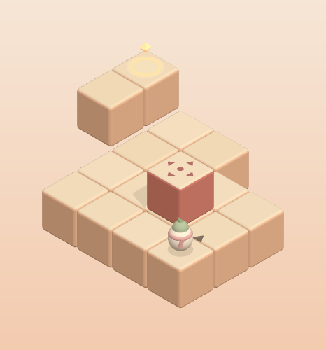
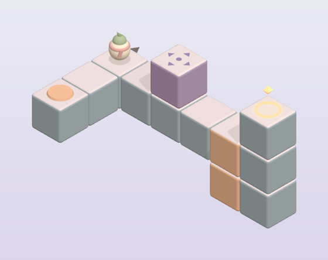
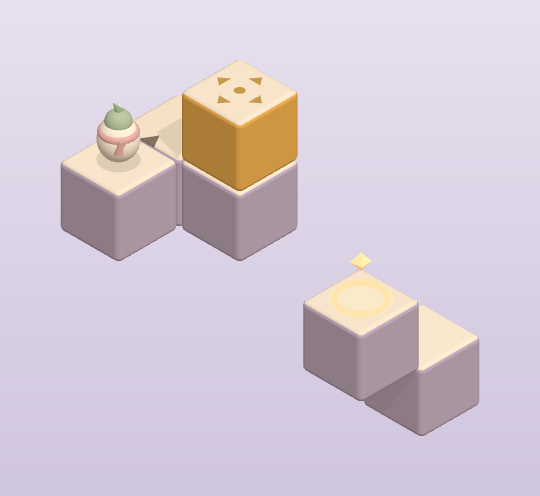
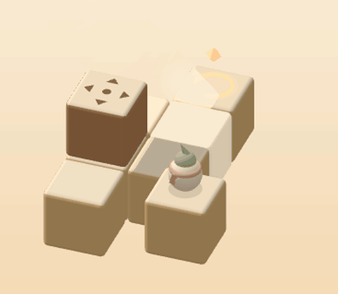
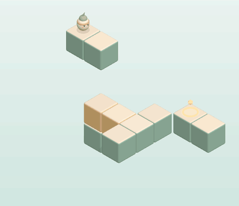

# Sightline

A small isometric puzzle game about perspective. Turn the camera until two far-apart ledges line up on screen, and they become one path.

<p align="center">
  
</p>

## How it plays

Pip walks on the tops of blocks. The world is real 3D, but **whatever lines up on screen is walkable**: turn the camera until two tops meet, and Pip can step across, even if they're metres apart in depth.

Every level adds one new idea on top of the last, and nothing tells you what it is. Work it out by looking.

<p align="center">
  
</p>

<p align="center">
  
  
  
  
</p>

## Six worlds

24 levels across six small worlds, four levels each. Each world adds a new kind of trouble:

| World | Levels | What's new |
|---|---|---|
| **Morning Garden** | 1–4 | Ledges that only meet on screen. Real stairs. Routes that need more than one angle. |
| **Tea House** | 5–8 | Blocks that move when you push them, and are something to stand on once they stop. |
| **Cloud Library** | 9–12 | Plates that lift parts of the shelves, and edges worth pushing things over. |
| **Lantern Hill** | 13–16 | Lanterns don't fall where they are. They fall where they look like they are. |
| **Sun Court** | 17–20 | Mist you can't stand on, unless something keeps the sun off it. |
| **Paper Theatre** | 21–24 | Parts of the stage turn whenever the camera does. |

<p align="center">
  
  
</p>

## Controls

| Action | Keyboard and mouse | Touch |
|---|---|---|
| Walk | <kbd>W</kbd> <kbd>A</kbd> <kbd>S</kbd> <kbd>D</kbd> | Tap beside Pip, on the side you want to go |
| Turn the camera | Hold <kbd>Q</kbd> / <kbd>E</kbd>, or drag with the right mouse button | Drag with one finger |
| Zoom | Mouse wheel | Pinch |
| Undo / Restart | <kbd>Z</kbd> / <kbd>R</kbd> | The ↶ / ↻ buttons |
| Next level (after a win) | <kbd>Space</kbd> or <kbd>Enter</kbd> | **Next Level** |
| Pause / Back | <kbd>Esc</kbd> | The ❚❚ button |

Let go of the camera near one of the snap angles and it settles there. That's when edges line up.

## Run it locally

Needs [Node.js](https://nodejs.org) 18 or newer.

```bash
npm install
npm run dev      # http://localhost:5173
npm run build    # static site in dist/
```

It's a plain static site, so any static host works. On Vercel, import the repo and keep the defaults (Vite is detected automatically).

## Built with

- [Three.js](https://threejs.org) for the scene, with an orthographic camera at the true isometric pitch.
- [Vite](https://vitejs.dev) for the dev server and build.
- The Web Audio API for all music and sound, synthesised live, with no audio files.

What counts as "lined up" comes from ray-casting each top face toward the camera, checked against a GPU picking pass so the rules match exactly what's drawn.
